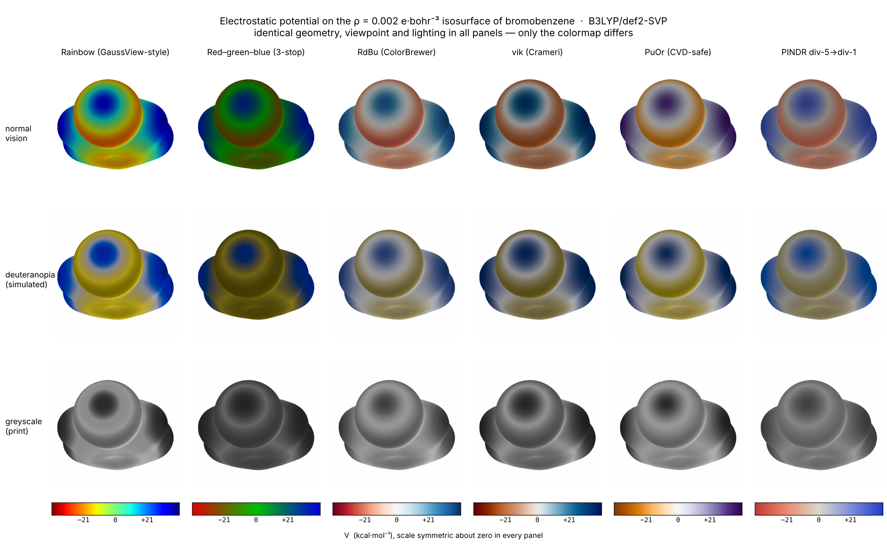

# espmap

Electrostatic-potential maps for organic molecules, from a SMILES string or a
structure drawn in any editor — with a colour scale chosen from the data rather
than from habit.

```bash
pip install -e .
python esp_map.py --selftest
python esp_map.py --smiles "Clc1ccccc1" --lim 25 --out esp.png
```

No install needed to try it: [](https://colab.research.google.com/github/Azuromalachite/espmap/blob/master/notebooks/espmap_colab.ipynb)
(type a SMILES, then *Runtime → Run all*; a rotatable 3D surface, an image and a zip of results come back).



*The same bromobenzene surface, identical geometry, viewpoint and lighting in
every panel — only the colormap differs. Rows: normal vision, simulated
deuteranopia, greyscale.*

> **Scope.** This is research code, written for one project and published
> because the pipeline is reusable. It works and it is tested, but it is **not
> a maintained package**: there is no support commitment and no stability
> guarantee. Fork it rather than depend on it.

---

## What it does

1. DFT single point (PySCF)
2. electron density on a regular grid
3. marching cubes at ρ = 0.002 e·bohr⁻³, the density surface of Bader et al.
   (1987); for the molecules measured here it encloses 98.5–99.1 % of the
   electrons (`bench/isosurface_enclosed.jsonl`)
4. **the ESP evaluated only at the isosurface vertices**, not on a volumetric grid
5. a z-buffered render with deliberately weak shading

**Step 4 is an implementation choice, not an invention.** A common route
writes two cube files, density and potential, then interpolates the second
onto an isosurface of the first. Quantitative molecular-surface methods have
long evaluated properties directly on a polygonal surface instead (Bulat et
al., *J. Mol. Model.* 2010; Lu & Chen, *J. Mol. Graph. Model.* 2012; see
[docs/prior-art.md](docs/prior-art.md)). espmap does the same inside a small
PySCF pipeline. What it adds is the measurement: evaluating the potential at
the ~10⁴ surface vertices instead of ~10⁶ grid points is about 100× cheaper,
and there is no interpolation error, because the potential is computed exactly
where it is displayed. Bromobenzene, end to end, on one core:

| step | time |
| --- | --- |
| SCF (141 basis functions) | 20.0 s |
| density on an 81×70×39 grid | 0.7 s |
| marching cubes → 10,400 vertices | <0.1 s |
| **ESP at those vertices** | **2.5 s** |
| render | 1.2 s |

No Gaussian, no GaussView, no cube files on disk.

## Speed: preview, density fitting, GPU

Measured on a 16-thread laptop CPU (Ryzen 7 260, 7.4 GB in WSL2), B3LYP, SCF
time only (`bench/`):

| molecule | basis functions (TZVP) | def2-SVP | def2-TZVP |
| --- | --- | --- | --- |
| chlorobenzene | 253 | — | 39 s |
| decanoic acid | 492 | 66 s | 211 s |
| C18 pheromone acetate | 898 | 182 s | 875 s |

- **`--basis def2-svp`** is the preview: right for pictures, but +1.53 to
  +2.82 kcal/mol low on V<sub>max</sub> for these four molecules (and off by +0.29
  to +2.37 on V<sub>min</sub>), so do not quote numbers from it.
- **`--density-fit`** changed V<sub>min</sub>/V<sub>max</sub> by ≤ 0.02 kcal/mol in every pair
  measured. It halves the SCF time at def2-TZVP up to ~600 basis functions
  (0.45–0.53 of the exact time) and saves 20–28 % at def2-SVP. At 898 it was
  *slower* (1,175 s vs 875 s), most likely because its integrals went to disk;
  time it on your machine before relying on it.
- **`--gpu`** runs the SCF on an NVIDIA GPU via
  [GPU4PySCF](https://github.com/pyscf/gpu4pyscf). On a Colab L4 it matched the
  CPU to < 0.001 kcal/mol and was 4.3× faster than the laptop above
  (`bench/gpu_l4.json`, commits 2313965 and 183ccd7). Validated for
  closed-shell, gas-phase, density-fitted runs only; any other combination
  prints a warning naming what is untested, and the JSON records
  `settings.gpu_validated`. With `--optimize`, the gradients run on the CPU.

## Outputs

```bash
python esp_map.py --smiles "CCO" --out esp.png \
    --html esp_3d.html --npz surface.npz --json results.json
```

- `--html`: an interactive 3D view (rotate, hover to read V, see-through
  toggle). Same colour map and scale rules as the image; works offline.
- `--npz`: the surface (vertices, faces, V, atoms) so it can be re-rendered
  without another SCF, with its units, method and both keys.
- `--json`: settings, energy, V range (`V_min_kcal_mol`, `V_max_kcal_mol`),
  the σ-hole (or `null` with the reason), the dipole as a vector about the
  centre of nuclear charge (an ion's dipole depends on the origin, so it is
  stated), the error-budget caveat, the **geometry actually computed**
  (`geometry.xyz_angstrom` in atom order, with a sha1 of the nuclei; pass it
  back with `--atoms` to recompute the run; `em.reproduce_argv(record)` builds
  the full command line, which keeps the `analysis_key`) and `provenance`: espmap version,
  `git describe --dirty` (or "unknown", never a guessed commit), the versions
  of Python, NumPy, SciPy, scikit-image, PySCF, RDKit and Matplotlib, and the
  thread count. Read
  `validity` before anything else. Compare **numbers** only between records
  whose `analysis_key` matches (method, solvent convention, surface, grid
  spacing and box margin, and how
  the geometry was made: `etkdg_mmff94s`, `dft:b3lyp/def2tzvp/water`,
  `mmff94s`, `idealised` for `--molecule`, or `undeclared` for a file or
  `--atoms` string that does not say; a file declares its origin with an
  `espmap_geometry_origin` (or `geometry`) SDF property, or
  `--geometry-origin`, which takes any of these labels), and
  **pictures** only when `render_key` matches as well (colormap, limits,
  camera). `key_fields` lists what each key hashes.

The record is versioned: `"schema": "espmap.record/1"`.
`docs/record-schema.json` is its complete key tree, and a test checks a real
record against it in both directions.

**Fixture records** (`fixtures/records/`) are six real records under that
contract, for anything built on top of espmap (Arrowfield's teaching layer
reads these first):

| fixture | method | sites |
| --- | --- | --- |
| benzene, nitrite, thiocyanate, enolate | B3LYP/def2-TZVP, PCM water, on DFT geometries optimised in the same | default (each heavy atom with its hydrogens) |
| Z3Z13-18:OAc, extended and folded (genus 3) | B3LYP/def2-SVP + RI, gas, MMFF94s conformers | by atom map: `C1-H` … `C18-H`, `head O`, `carbonyl O`, `acetyl` |

Every one is computed from a committed file with every atom supplied, so
nothing moves (`relaxation: "none"`). `fixtures/make_records.py` regenerates
them, and `tests/test_fixtures.py` checks each against:
- the schema;
- its input coordinates;
- site conservation;
- the NPZ's partition;
- its budget rows;
- benzene and nitrite symmetry.

Two details of the inputs:
- **C18 atom maps follow the chain** (map *n* = C*n*; acetyl 21/22, ester O
  31, carbonyl O 32), not SMILES order.
- **The nitrite input is its DFT geometry rotated rigidly out of z = 0.**
  v0.2.0's gate refused an exactly planar nitrite with two equal N–O bonds
  as `DIMENSION_AMBIGUOUS`. The current gate keeps it, and the fixture input
  stays rotated so the frozen records do not change.

## Ensembles

A flexible molecule is not one geometry. On the C18 acetate the median site
mean moves 5.1 kcal/mol across conformers, more than the basis-set row of the
error budget. `--ensemble` computes a conformer ensemble as one record,
`espmap.ensemble/1` (`docs/ensemble-spec.md`, `docs/ensemble-schema.json`):

```bash
python esp_map.py --smiles "CC(=O)OCC/C=C\CCCCCCCC/C=C\CCCC" --ensemble 10 \
    --basis def2-svp --density-fit --ensemble-dir c18 --subject Z3Z13-18OAc
python esp_map.py --file poses.sdf --ensemble supplied --ensemble-dir poses
```

- **Generated** (`--ensemble K`): ETKDG + MMFF94s, deduplicated at a
  symmetric heavy-atom RMSD of 0.35 Å, then K members spread across the
  radius of gyration, the lowest-energy one first. Fewer than K is reported,
  never padded. **Supplied** (`--ensemble supplied`): every record of a
  multi-record file, which must all be one molecule, one stereoisomer and one
  atom order (isotope labels included).
- Each member is an ordinary `espmap.record/1`, computed in its own process
  into `ENSEMBLE_DIR/conformers/`. The directory holds a run manifest: a
  rerun with the same protocol resumes, and a rerun under another basis,
  solvent, molecule or member set is refused
  (`ENSEMBLE_RESUME_PROTOCOL_MISMATCH`). Use a new directory for that.
- The record states each member's shape (Rg, extent, asphericity, contacts),
  whether it is **folded** (a heavy-atom contact six or more bonds apart),
  every excluded member with its reason, and per-site statistics over all
  members and over the extended ones.
- `validity.convergence` is `true`, `false`, or `null` when it can't be
  judged (fewer than 3 usable members). The tolerance is provisional.
- Statistics are **unweighted**. `--weight dft --optimize` weights by
  Boltzmann factors of the SCF energies of the optimised members. Members
  are described by their final geometries, and starts that reach one minimum
  count once (`MEMBER_DUPLICATE_MINIMUM`). These are electronic-energy
  weights, not a thermodynamic population (no zero-point, thermal or
  entropic terms). MMFF energies never weight.
- `ensemble_key` names the molecule, the protocol and the ordered members:
  two different ensembles never share it.

## Input

```bash
python esp_map.py --smiles "CN1C=NC2=C1C(=O)N(C(=O)N2C)C"   # caffeine
python esp_map.py --file drawn.cdxml                        # ChemDraft / ChemDraw
python esp_map.py --file structure.mol --check              # gate only, no compute
```

`--file` reads `.mol .sdf .cdxml .xyz .pdb`. A structure **drawn** in an editor
and exported as MOL/SDF/CDXML is a picture, so its coordinates are discarded,
a conformer is generated, and the run says so loudly. A file is treated as a
drawing when its header says 2D. A file whose header says 3D but whose atoms
all lie within 0.1 Å of one plane (anywhere, tilted or not) is judged from
its bonds and angles:
- an sp³ atom lying flat where no real molecule can put it makes it a
  drawing: three or more neighbours, a ring with a bond between two sp³
  atoms (cyclohexane, THF; fluorene's lone CH₂ is flat in reality too), or
  an open-chain bend outside 90–118°. A file whose only such problem is a
  ring, and which sits more than 0.01 Å off its plane, is refused instead:
  real 1,3-cyclohexadiene is nearly flat;
- every bond the same length at a drawing program's standard (1.5, 1.54 or
  0.825 Å) makes it a drawing across two or more element pairs. With one
  pair it is a drawing only if that length fits none of the bonds drawn
  (benzene or CO₂ drawn at 1.5 Å), and is otherwise refused with
  `DIMENSION_AMBIGUOUS` (nitrate drawn at 1.5 Å: its N–O single bond could
  be that long);
- otherwise it is kept as a geometry if every bond is near its
  covalent-radius length for its bond order: within 5 % for a bond to an
  sp³ carbon or a C=C, 10 % otherwise (C₆F₆, BF₃, the DFT nitrite, uracil);
- anything else is a drawing if its bonds are uniform across two or more
  element pairs and some bond is well outside its tolerance (1.3 times),
  and is refused otherwise. A flat sp³ four-membered ring is refused too.

`.xyz` and `.pdb` are never drawings. The rule was written against 100
hostile flat files built first (`tests/data/r11`); seven of them are refused
where a better answer exists, among them real ozone and real isoxazole (aromatic N–O 10 % long against the reference). Known
limit: a drawing within those tolerances of a real geometry is computed as
one. A file carrying real 3D coordinates
is used as-is, with any missing hydrogens added and relaxed against frozen
heavy atoms.

A file with more than one record (an SDF of docking poses) is refused; pass
`--record N` to compute record *N*. The JSON records which one under
`input.record`.

## The structure gate

Every structure is checked **before** any geometry or SCF work. A drawing can
be perfectly legible to a chemist and still be ambiguous to a machine, and the
pipeline would otherwise compute a flawless map of a molecule you did not mean.

| | |
| --- | --- |
| **Rejected** | valence and charge errors; R-groups and query atoms; radicals without `--spin`; disconnected fragments |
| **Warned** | undrawn E/Z geometry; two or more unwedged stereocentres; untested elements |
| **Noted** | one unspecified stereocentre; reachable tautomers; net charge; isotopes |

With `--require-stereo`, every stereo element the input leaves open is
**rejected** instead (`STEREO_REQUIRED`):
- a stereocentre (C, or a stable S, P or N centre) or a cis/trans ring pair without `@`/`@@` or a wedge;
- a double bond, a C=N or an N=N in a chain or a ring of eight or more without `/`/`\` or a drawn geometry;
- anything a drawing marks "either" (a crossed double bond, a wavy single bond);
- a stereogenic allene or cumulene, a hindered biaryl axis or a helicene of five rings or more, which no SMILES can fix.

A real 3D geometry (MOL/SDF with z, XYZ, PDB, `--atoms`) fixes every element and always passes. A centre that
exists only because of an isotope label is ignored, as the ESP cannot see it. The rule was written against
106 cases built first (`tests/data/stereo`).

Each finding names what to change *in the structure*, not in the code. A salt
is rejected rather than averaged: forcing sodium acetate through reaches
**+113 kcal/mol** against **+61** for acetic acid's own proton — the
counter-ion *is* the map.

## The colour scale

**The general argument is not new.** The case against rainbow colour maps in
science is twenty years old and thoroughly made — see
[Crameri, Shephard & Heron, *Nature Communications* **11**, 5444 (2020)](https://doi.org/10.1038/s41467-020-19160-7)
and [Moreland's work on diverging maps](https://www.kennethmoreland.com/color-maps/).
What this repository adds is the measurement for *this* field, where the
defaults still ignore it.

Perceptual units are CAM02-UCS ΔE′ (≈2 is just noticeable), measured on a real
ESP surface:

| colormap | **chroma at V = 0** | lightness at V = 0 | 0↔negative, deuteranopia |
| --- | --- | --- | --- |
| rainbow (GaussView-style) | **33.7** | 90 | 59 |
| red–green–blue (3-stop) | **39.4** | 68 | **13** |
| RdBu | 2.4 | 98 | 73 |
| vik (Crameri) | 1.1 | 93 | 73 |
| PuOr | 2.3 | 98 | 64 |

A diverging scale must be *least* saturated where the data is least
meaningful. The conventional maps are near their own maximum chroma at zero,
so the eye is pulled hardest to the value that means nothing is happening. And
because the midpoint colour is not the least-chromatic colour, the perceived
neutral is **displaced to t = 0.727** along the ramp rather than 0.5.

Three rules the tool enforces:

- **Symmetric about zero — only if the field changes sign.** An ion's surface
  never does. Benzoate runs −158.7 to −40.7 kcal/mol; a diverging map centred
  on zero collapses 117 kcal/mol of structure into one flat colour. `espmap`
  detects this and switches to a sequential scale. "Changes sign" means the
  minority sign reaches more than 5 % of the larger extremum: a cation at
  −0.01 to +120 is sequential, as it would be at +0.01. The ratio is printed
  and written to the JSON (`scale.sign_change_ratio`).
- **No specular highlight.** A white patch at a position set by the camera
  reads as a potential extremum. Shading is held to a narrow 0.62–1.0 span so
  the colormap's own lightness carries the data.
- **Orientation asserted in code.** All eleven colormaps are checked by
  `--selftest`; three shipped inverted before that check existed.

Honest consequence, measured: **no symmetric diverging map survives
greyscale** — RdBu separates its ends by ΔE′ = 3 and vik by 7, because
symmetry in lightness is exactly what makes ±V print identically. If the
figure will print in one colour, add a zero isoline rather than changing hue.

## Error budget

A property computed to three decimals is worthless without one. Measured on
the chlorobenzene σ-hole V<sub>max</sub>, B3LYP unless stated:

| axis | effect | note | data in `bench/` |
| --- | --- | --- | --- |
| **basis set** (def2-SVP → def2-TZVPP) | **+3.54** | +6.35 → +9.90; dominant | `error_budget.jsonl` |
| **solvent** (gas → PCM water), polarised solute | **−3.60** | +9.83 → +6.22; co-dominant | `solvent_convention.jsonl` |
| solvent (gas → chloroform), polarised solute | −2.69 | +7.14 | `solvent_convention.jsonl` |
| solvent (gas → PCM water), solute + reaction field | +0.05 | +9.88; chloroform −0.34 (+9.49) | `solvent_convention.jsonl` |
| functional (B3LYP / PBE0 / M06-2X / HF) | 0.69 | spread, +9.51 to +10.20 | `error_budget.jsonl` |
| conformer (lowest vs highest MMFF) | ~1 | glycerol; C18 acetate: 1.1 over 8 extended conformers, **5.2** on V<sub>min</sub> once folded ones are included | `conformers.jsonl`, `f9_recheck.jsonl` (glycerol: prose) |
| density fitting (`--density-fit`) | ≤ 0.02 | 7 pairs, always upward on V<sub>max</sub> | `results.jsonl` |
| GPU vs CPU (`--gpu`) | < 0.001 | decanoic acid, density-fitted | `gpu_l4.json` |
| stereochemistry (diastereomers) | 1.6–1.9 | threonine, def2-SVP, mean of 3 MMFF seeds; seeds of one diastereomer spread up to 1.25 | `error_budget.jsonl` |
| geometry source (MMFF / idealised / DFT) | 0.40 | +9.54 to +9.94; **small anions: up to 6.5** (MMFF nitrite N–O 1.42 Å vs 1.25) | `error_budget.jsonl`, `anion_geometry.jsonl` |
| grid spacing (0.26 → 0.16 bohr) | 0.04 | converged | `error_budget.jsonl` |
| σ-hole region definition | 0.00 | 9 cones, all +9.83; max is interior to the cone | `error_budget.jsonl` |

Two rows changed when they were re-measured into `bench/` (review 3 H8). The
stereochemistry row had read "~0.9 against a 0.4 noise floor": threonine's
diastereomers in fact differ about as much as its conformers do. The geometry
row moved from 0.35 to 0.40 with a fresh DFT-optimised geometry, and it does
not transfer to small anions. The basis and water rows are +3.54 and −3.60
from the unrounded values; the old +3.55 and −3.61 were differences of
rounded endpoints.

**Per-site statistics** (the `sites` block) carry their own budget: the same
surface split two ways, by nearest nucleus and by d / r<sub>Bondi</sub>, and the
same site on other conformers and grids. Site means unless stated, kcal/mol,
nearest-nucleus rule and 0.26 bohr unless stated:

| axis | effect | note | data in `bench/` |
| --- | --- | --- | --- |
| partition rule, small anions | ≤ 3.0 | enolate, SCN⁻, NO₂⁻ in PCM water; largest on the enolate C bonded to O, which the radius rule hands part of O's surface | `site_partition.jsonl` |
| partition rule, C18 acetate | ≤ 3.95 | 10 conformers; median site 0.89, largest at the ester carbonyl C | `site_partition.jsonl` |
| partition rule, **single atoms** (`atoms`, H not folded) | up to 11.9 | the small anions above plus chlorobenzene (gas), def2-TZVP, on the same surfaces as the grid rows. The rules trade area between a heavy atom and its own hydrogens (up to 5.2×); atoms with no hydrogens move ≤ 0.85. On the 10 C18 acetate conformers (def2-SVP + RI, gas) the nearest-nucleus rule leaves 14–15 of the 22 heavy atoms with no surface at all, and an atom that has area under both rules moves by up to 8.7. **Atom values are diagnostic; quote `reaction_sites`** | `site_partition.jsonl` |
| partition rule, 5th percentile | up to 8.9 | the tail is the fragile statistic; lead with the mean | `site_partition.jsonl` |
| conformer, C18 acetate | 5.1 | median site's spread over 10 conformers, folded ones included (max 8.3): above the partition effect at almost every site. Over the 8 extended conformers alone: 2.69 (max 5.16). Extended means a genus-0 surface; the 2 folded conformers have genus 2 and 3 | `site_partition.jsonl` |
| grid spacing (0.26 → 0.16 bohr) | 0.15 | mean; 5th percentile 0.72, site V<sub>min</sub> 0.54, areas ≤ 1.7 % | `site_partition.jsonl` |

Site areas sum to the surface area to 2×10⁻¹⁶ under both rules. A site's
V<sub>min</sub> is far more grid-sensitive than the global V<sub>max</sub> row above.

**The solvent rows measure a convention.** With `--solvent`, the map is the
potential of the solute *as polarised by* the continuum; the potential of the
continuum's own surface charges (the reaction field) is left out. That is the
default and the convention behind the −3.60. `--include-reaction-field` adds
the reaction field, and then the solvent shift is +0.05 in water and −0.34 in
chloroform: the polarisation of the solute and the field of the solvent that
caused it almost cancel on this surface. Both are legitimate quantities; they
answer different questions, and the JSON records which one (`solvent_esp`,
part of `analysis_key`). def2-TZVP, `bench/solvent_convention.jsonl`; at
def2-SVP the shifts are −3.10 and +0.57.

**The basis-set error is molecule-specific and cannot be calibrated away**: the
same def2-SVP → def2-TZVP change moves bromobenzene by **−0.76**, opposite in
sign and a fifth the magnitude. Across four target molecules in
`bench/results.jsonl` it moves V<sub>max</sub> by **+1.53 to +2.82** (the C18 alcohol
+1.53; decanoic acid, BDSF and the C18 acetate +2.65 to +2.82) and V<sub>min</sub> by
+0.29 to +2.37, the alcohol again the outlier, this time the largest.
Checking one molecule licenses nothing about another.

**Conformation moves shape more than extrema, until the molecule folds.**
Across eight extended conformers of the C18 acetate, V<sub>min</sub>/V<sub>max</sub> varied by
~1.1 kcal/mol while the dipole varied 43 % and the negative surface area 13 %.
The two folded conformers moved V<sub>min</sub> by up to 5.2 kcal/mol and the negative
area by 60 % (`bench/conformers.jsonl`, `bench/f9_recheck.jsonl`). For a
flexible molecule, sample folded shapes before quoting an extremum.

Two consequences for anyone quoting a number from this:

- the default basis is **def2-TZVP**, and anything double-zeta prints a warning
  naming the measured penalty;
- the default is **gas phase**, stated in every run, and `--solvent water`
  changes the answer by as much as the basis does, under the default
  (polarised-solute) convention;
- a gas-phase anion whose outer electron is unbound (HOMO above zero) is
  warned: its map follows the basis set, and `--solvent water` binds it.

## Limits

- `ωB97X-D` is unavailable in this PySCF build, so range-separated functionals
  with dispersion are **untested**.
- Geometries from `--smiles` are force-field (MMFF94s), adequate for local
  electronic properties at 0.40 kcal/mol on chlorobenzene, **not** for small
  anions (up to 6.5 kcal/mol), and **not** for conformational energies or
  barriers. `--optimize` runs a DFT optimisation (needs
  `pip install 'espmap[opt]'`, which adds pyberny). It is tested on methanol
  and the glycine zwitterion, and was run on nitrite, SCN⁻ and the enolate at
  def2-TZVP in PCM water before v0.2.0. It is not yet tried on a flexible
  molecule.
- The gate checks that a structure is *unambiguous*. It cannot tell you it is
  the molecule you meant to draw: a cleanly drawn wrong tautomer passes with a
  note.
- Fluorine deliberately reports no σ-hole, because it does not form one.
- Only closed-shell and simple open-shell (`--spin`) species; no excited
  states, no periodic systems, no transition metals validated.
- `--gpu` is validated only for closed-shell, gas-phase, density-fitted runs;
  solvent, open-shell and exact-integral runs on the GPU are untested, and
  warned as such.
- A folded molecule can give a closed surface with handles (genus > 0). That
  is accepted with a note; an *open* (clipped) surface is still refused.

## Tests

```bash
pip install -e ".[test]"
pytest                      # fast tests, seconds, no SCF
pytest --runslow -m slow    # tests with real DFT, a few minutes
```

Every test is a defect that actually shipped at some point, lifted from the
adversarial reviews in `docs/`. The reviews are included deliberately: they
record what was measured, what was wrong before, and what remains untested.
Among the findings they document — a sign-flipped Coulomb kernel caught only
by far-field decay, a validation check that could not fail, a clipped
isosurface that changed a value by 26 % silently, and a conclusion whose margin
was smaller than its own basis-set error.

## Credit

Built on [PySCF](https://pyscf.org), [RDKit](https://rdkit.org),
[scikit-image](https://scikit-image.org) and
[cmcrameri](https://github.com/callumrollo/cmcrameri). The `vik`, `broc`,
`cork`, `lajolla` and `batlow` maps are Fabio Crameri's *Scientific colour
maps*; please cite them if you use the figures.

The chemistry is not new. The electrostatic potential on the ρ = 0.002
surface, its extrema and statistics, and the σ-hole are established methods
(Politzer, Murray, Clark and co-workers; Bader; Bulat et al.; Lu & Chen and
Multiwfn). [docs/prior-art.md](docs/prior-art.md) lists what espmap uses,
what it adapts and what may be specific to it, and
[docs/references.bib](docs/references.bib) has the verified references. To
cite espmap itself, see [CITATION.cff](CITATION.cff).

AI-assisted coding tools (Claude, via Claude Code) were used for
implementation and adversarial review; those commits carry a
`Co-Authored-By` line. The scientific specification, acceptance criteria and
interpretation are the author's, and every change is tested against the
invariants in `CLAUDE.md` and the data in `bench/`.

MIT licensed. If it is useful in published work, a link back is appreciated but
not required.
